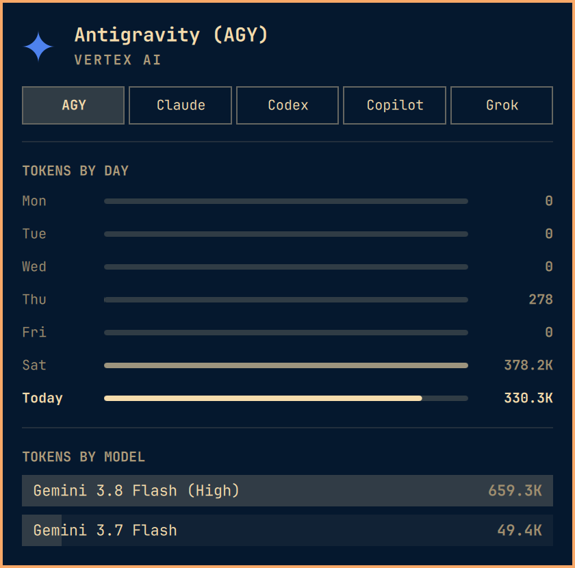

# AI Agents for Omarchy

A comprehensive, native Omarchy status bar panel and widget for tracking AI coding assistants and models.

<p align="center">
  <b>Antigravity (AGY)</b> • <b>Claude Code</b> • <b>OpenAI Codex</b> • <b>GitHub Copilot</b> • <b>Grok CLI</b> • <b>Fireworks AI</b>
</p>

<p align="center">
  
</p>

---

## Features

- **Unified Multi-Agent Dashboard**: Monitor subscription limits, token consumption, and session activity across all your AI assistants in a single panel.
- **Deep Token Tracking & Analytics**:
  - **Antigravity (AGY)**: Full Vertex AI session history, Gemini 3.8/3.7 Flash & 2.5 Pro token breakdown (input, output, cache-read, and cache-creation), 7-day token history bars, and session counts.
  - **Claude Code**: Live 5-hour rolling session window and 7-day weekly rate limits with reset countdowns, daily prompt and session token totals, and model tracking.
  - **OpenAI Codex**: Live primary window (5h) and secondary window (7d weekly) limits via robust non-blocking RPC, daily session counts, and model breakdown.
  - **GitHub Copilot**: CLI session tracking, daily prompt totals, output token counts, cache-read tracking, and model breakdown.
  - **Grok CLI**: Local session token consumption (input, output, cached), daily prompts, active session tracking, Grok 4.6 breakdown, and 7-day history.
  - **Fireworks AI**: Optional prepaid balance tracking, remaining vs funded credits, and rate limit utilization.
- **Polished Responsive UI**:
  - Clean tab navigation with automatic button text elision, clipping, and hover tooltips.
  - Status indicators that reflect account readiness without false warning banners.
  - Dark and light theme SVG icons for every agent.
- **Self-Contained & Plug-and-Play**:
  - Bundled collectors—no external helper scripts or manual setup required.
  - Native integration with Omarchy Shell and OmaSettings.

---

## Installation and Removal

Install directly into Omarchy using the `omarchy plugin` CLI:

```bash
omarchy plugin add https://github.com/nertwork/omarchy-ai-agents.git --enable
```

To update to the latest version:

```bash
omarchy plugin update jfarr.agents
```

To remove the plugin:

```bash
omarchy plugin remove jfarr.agents
```

---

## Dependencies

- **Omarchy Desktop / Omarchy Shell**: Required plugin host runtime and top bar container.
- **Python 3**: Uses only the Python standard library for the bundled metrics collector.
- **Optional Provider CLI Tools**: The plugin monitors local session logs and auth states for the tools you have installed:
  - Antigravity (`agy` / Vertex AI ADC credentials)
  - Claude Code (`claude` / Anthropic OAuth)
  - OpenAI Codex (`codex` / ChatGPT session state)
  - GitHub Copilot (`copilot` / GitHub CLI session state)
  - Grok CLI (`grok` / xAI CLI auth state)

---

## Supported Agents & Token Tracking

| Agent | Source / Provider | Tracked Metrics & Token Analytics |
|---|---|---|
| **Antigravity (AGY)** | Google Vertex AI ADC | Today's prompts & sessions, today's total tokens, input/output/cache-read/cache-creation token breakdown, Gemini 3.8/3.7 Flash & 2.5 Pro breakdown, 7-day token history |
| **Claude Code** | Anthropic OAuth | 5-hour rolling limit window, 7-day weekly rate limit, live reset countdowns, daily prompts and session token totals, active model breakdown |
| **OpenAI Codex** | OpenAI ChatGPT Plus/Pro | 5-hour primary limit window, 7-day secondary limit window, non-blocking RPC state refresh, daily session counts, model breakdown |
| **GitHub Copilot** | GitHub CLI Copilot | Daily prompts & sessions, total output tokens, input and cache-read tokens, model breakdown, 7-day history |
| **Grok CLI** | xAI CLI Auth | Daily prompts & sessions, total token consumption, input/output/cached tokens, Grok 4.6 breakdown, 7-day history |
| **Fireworks AI** | Fireworks API (Optional) | Credit balances, remaining vs funded prepaid allowances, rate limit utilization |

---

## Shortcuts & Controls

- **Left-Click (Bar Icon)**: Toggle panel open / closed.
- **Middle-Click (Bar Icon)**: Cycle to next active AI agent.
- **Right-Click (Bar Icon)**: Launch default agent selector (`omarchy-agent --pick`).
- **Keyboard Navigation (inside panel)**:
  - `h` / `l` or `Left` / `Right`: Switch agent tabs.
  - `r`: Force immediate refresh of usage and limits.
  - `Esc`: Close panel.

---

## Configuration

You can configure AI Agents via OmaSettings or directly in `~/.config/omarchy/shell.json`:

```json
{
  "id": "jfarr.agents",
  "refreshIntervalSec": 900,
  "providers": {
    "agy": { "enabled": true },
    "claude": { "enabled": true },
    "codex": { "enabled": true },
    "copilot": { "enabled": true },
    "grok": { "enabled": true }
  }
}
```

---

## License

MIT License. See [LICENSE](LICENSE) for details.
